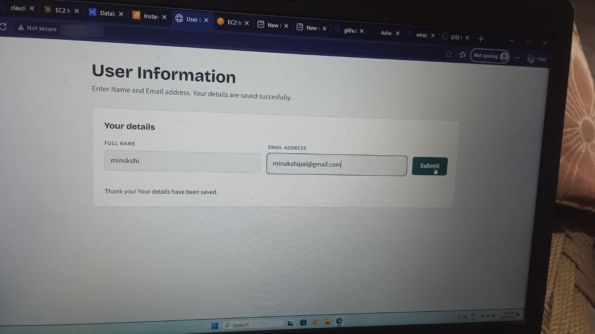
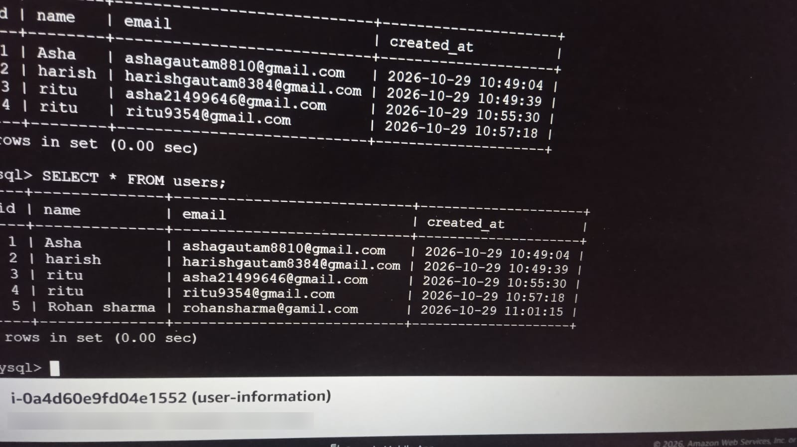
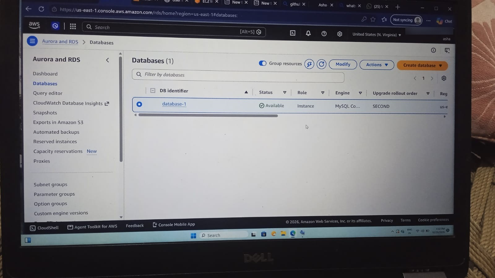
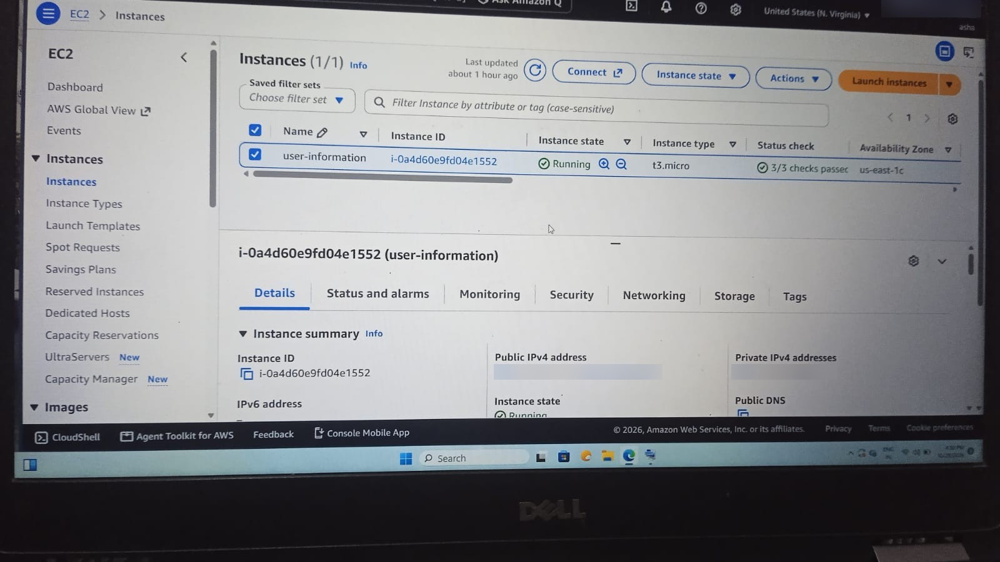

# User Information

A web form that saves a name and email to **Amazon RDS (MySQL)** and shows the entries on a password-protected admin page.

## Problem and Solution

**Problem:** collecting user details by hand is messy, and the data can be lost, duplicated or seen by anyone.

**Solution:** a web form that stores entries in a private database, blocks duplicate emails and spam, and shows the data only to an admin.

## Architecture

```
Browser -> Nginx (port 80) -> Node.js + Express (port 3000, pm2) -> RDS MySQL (private)
```

## Tech Stack

Node.js, Express, MySQL (mysql2), Nginx, pm2, AWS EC2, AWS RDS

## Features

- Public form: `POST /api/users`
- Admin page `/admin` and `GET /api/users` (HTTP Basic auth)
- Duplicate emails are not saved twice
- Rate limit: 10 submissions per IP per 15 minutes
- Parameterised SQL queries (no SQL injection)
- RDS is private (Public access: No); port 3306 is open only to the EC2 security group

## Screenshots

### Form (data saved successfully)


### Data stored in MySQL (RDS)


### RDS database (Available)


### EC2 instance (Running)


## What I learned

- Deployed a Node.js app on AWS EC2 and connected it to a private RDS MySQL database
- Used security groups so only the EC2 server can reach the database
- Kept the app running with pm2 and served it on port 80 with Nginx (reverse proxy)
- Kept passwords out of the code with a `.env` file
- Debugged real errors (for example `getaddrinfo ENOTFOUND` caused by a wrong `DB_HOST`)

## Documentation

Full server setup (Nginx, pm2, MySQL client, `.env`, errors and fixes): see [DEPLOYMENT.md](DEPLOYMENT.md)

## Before real use

- Add HTTPS (domain + Let's Encrypt), because Basic auth over HTTP is unencrypted
- Use AWS Secrets Manager for the database password

*The AWS resources were deleted after testing to avoid charges.*
